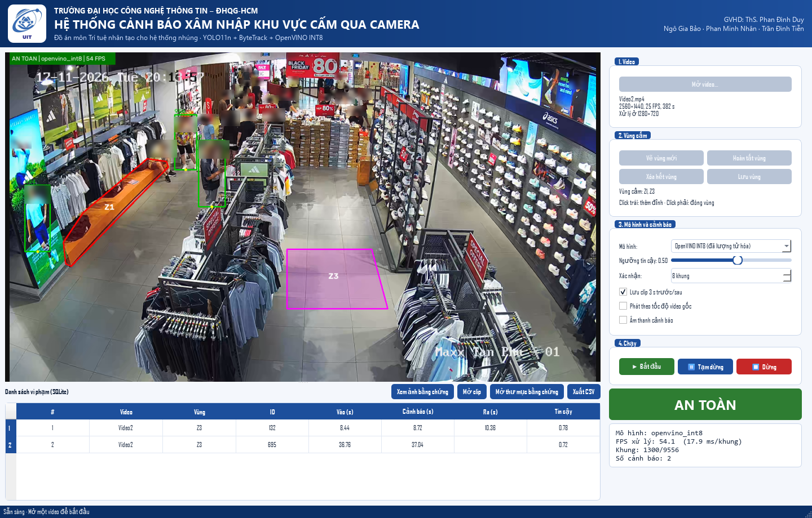
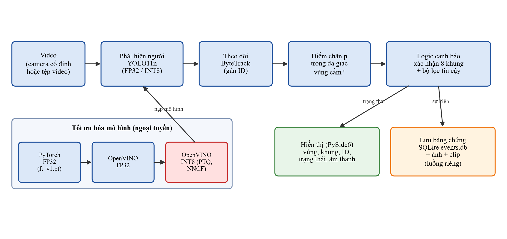

# Hệ thống phát hiện và cảnh báo người xâm nhập khu vực cấm qua camera

**Development of an Automated Camera-Based System for Detecting and Alerting Human Intrusion into Restricted Areas**

Đồ án môn **Trí tuệ nhân tạo cho hệ thống nhúng (CE340)** – Trường Đại học Công nghệ Thông tin, ĐHQG-HCM
GVHD: ThS. Phan Đình Duy · Nhóm: Ngô Gia Bảo (25210061) · Phan Minh Nhân (25210153) · Trần Đình Tiễn (25210216)



---

## Mục lục
1. [Mục đích của đồ án](#1-mục-đích-của-đồ-án)
2. [Kết quả chính](#2-kết-quả-chính)
3. [Kiến trúc hệ thống](#3-kiến-trúc-hệ-thống)
4. [Cấu trúc thư mục](#4-cấu-trúc-thư-mục)
5. [Cài đặt môi trường và tải dữ liệu](#5-cài-đặt-môi-trường-và-tải-dữ-liệu)
6. [PHẦN A – Chạy app demo (5 phút)](#6-phần-a--chạy-app-demo-5-phút)
7. [PHẦN B – Thực hiện lại toàn bộ đồ án từng bước](#7-phần-b--thực-hiện-lại-toàn-bộ-đồ-án-từng-bước)
8. [Báo cáo, slide và tài liệu](#8-báo-cáo-slide-và-tài-liệu)
9. [Lỗi thường gặp](#9-lỗi-thường-gặp)

---

## 1. Mục đích của đồ án

Camera giám sát ở nhà xưởng, công trường, cửa hàng thường vẫn do con người theo dõi nên dễ bỏ sót những lần có người đi vào vùng cấm chỉ trong vài giây. Đồ án xây dựng một ứng dụng **tự động phát hiện người đi vào vùng cấm và phát cảnh báo kèm bằng chứng**, chạy được trên **CPU** (mô phỏng thiết bị biên không có GPU).

Trọng tâm theo yêu cầu môn học là **tối ưu hóa và lượng tử hóa mô hình**. Câu hỏi nghiên cứu:

> *Lượng tử hóa INT8 giúp mô hình YOLO11n nhanh và nhẹ hơn bao nhiêu, và có làm giảm khả năng cảnh báo xâm nhập hay không?*

Cách làm tổng quát:
- **YOLO11n** phát hiện người → **ByteTrack** gán ID theo dõi → lấy **điểm chân** p = ((x1+x2)/2, y2) → kiểm tra p có nằm trong **đa giác vùng cấm** → **xác nhận 8 khung hình** (0,32 s) rồi mới cảnh báo, mỗi lượt vào chỉ báo một lần.
- Từ cùng một mô hình đã fine-tune, tạo 3 phiên bản **PyTorch FP32 → OpenVINO FP32 → OpenVINO INT8** (lượng tử hóa sau huấn luyện – PTQ – bằng NNCF) và so sánh trên cùng dữ liệu, cùng máy.
- Đánh giá ở **2 cấp**: mô hình (mAP, tốc độ, dung lượng, RAM) và hệ thống (số lượt báo đúng, bỏ sót, báo nhầm, độ trễ cảnh báo).
- Mỗi lượt vi phạm được lưu vào **SQLite** cùng ảnh toàn cảnh, ảnh người vi phạm và clip 6 giây; giao diện **PySide6**.

Quy trình 6 bước của môn học: (1) định nghĩa bài toán, chọn phần cứng → (2) thu thập, tiền xử lý dữ liệu → (3) huấn luyện → (4) tối ưu hóa → (5) chuyển đổi, triển khai → (6) kiểm thử thực tế.

## 2. Kết quả chính

| Nội dung | Kết quả |
|---|---|
| Phát hiện người trên ảnh (1.945 ảnh test) | mAP@50: **0,549 → 0,604** sau fine-tune |
| Cảnh báo trên 10 video CAVIAR (33 lượt) | Báo đúng **2/33 → 32/33**; 5 video kiểm thử **14/14**, độ trễ trung vị **~0,3 s** |
| INT8 so với OpenVINO FP32 | Nhỏ hơn **3,2×** (3,3 MB / 10,4 MB) · nhanh hơn **~2,15×** (14,0 / 30,0 ms/khung, CPU 4 luồng, ~71 FPS) · mAP@50–95 chỉ giảm **0,13 điểm %** |
| Chất lượng cảnh báo INT8 (12 video) | 74/96 lượt đúng (FP32: 75/96) |
| Toàn hệ thống (INT8, video 2K, có lưu bằng chứng) | **39–54 FPS** trên CPU i7-12700H |
| Hạn chế | Video cửa hàng (cảnh chưa từng huấn luyện) còn báo nhầm do quần áo treo bị nhận là người; ngưỡng tin cậy 0,5 giảm báo nhầm 37 → 2 nhưng mất 12 lượt đúng |

Chi tiết: [code/baseline/KET_QUA_MOC.md](code/baseline/KET_QUA_MOC.md), [code/optimize/KET_QUA_TOI_UU.md](code/optimize/KET_QUA_TOI_UU.md), báo cáo [Bao cao do an - Hoan chinh.pdf](Bao%20cao%20do%20an%20-%20Hoan%20chinh.pdf).

## 3. Kiến trúc hệ thống



- **Phần tối ưu (làm một lần, ngoại tuyến):** `ft_v1.pt` (PyTorch FP32) → `ft_v1_fp32_openvino_model` → `ft_v1_int8_c300_openvino_model`.
- **Phần chạy trực tuyến:** khung hình → mô hình → ByteTrack → kiểm tra từng vùng cấm → logic cảnh báo (+ bộ lọc tin cậy) → hiển thị và âm thanh; sự kiện được đưa qua hàng đợi sang **luồng riêng** để ghi SQLite, ảnh, clip (chỉ làm chậm ~4%).

## 4. Cấu trúc thư mục

```
camera-intrusion-alert/
├── README.md, requirements.txt
├── Bao cao do an - Hoan chinh.docx / .pdf      ← báo cáo đồ án (62 trang)
├── Slide bao ve do an.pptx                     ← slide bảo vệ (15 phút, 3 người)
├── Bao cao tuan 1..6.docx, Ke hoach ... .xlsx  ← báo cáo tuần, kế hoạch
├── code/
│   ├── setup_paths.py        ← chạy 1 lần sau khi clone
│   ├── download_data.py      ← tải 10 video CAVIAR
│   ├── core/                 ← lõi: alarm.py (logic cảnh báo), pipeline.py (luồng xử lý), evidence.py (SQLite)
│   ├── app/                  ← gui.py (giao diện), run_pipeline.py (dòng lệnh), assets/ (logo)
│   ├── models/               ← ft_v1.pt + các bản OpenVINO FP32/INT8 (640 và 416), yolo11n.pt
│   ├── labeling/             ← tạo nhãn CAVIAR, công cụ gán nhãn video, gán nhãn bán tự động Z3
│   ├── train/                ← trích khung CAVIAR, fine-tune, runs/ft_v1/results.csv
│   ├── baseline/             ← đánh giá ảnh/video, dò bộ lọc, so sánh FP32/INT8; results/
│   └── optimize/             ← xuất OpenVINO + INT8 (NNCF), đo tốc độ CPU; results/
├── Dataset/                  ← data.yaml, data_ft.yaml, moves.csv (ẢNH KHÔNG CÓ TRONG REPO – xem B1)
├── Videos/
│   ├── CAVIAR/               ← nhãn gốc *gt.xml, zones.json (vùng A), events_gt.csv (33 lượt), split.json (VIDEO .mpg TẢI BẰNG SCRIPT)
│   └── cua_hang_giay/        ← Video1.mp4, Video2.mp4, zones.json (Z1, Z3), events_gt.csv (63 lượt)
└── work/                     ← script kiểm tra/chia dataset; dựng báo cáo (report/), báo cáo tuần (tuan/), slide (slide/)
```

Trong repo chỉ có **2 video cửa hàng giày** (`Videos/cua_hang_giay/`). Không có trong repo, tải theo [mục 5.2](#52-tải-dữ-liệu): video CAVIAR (~100 MB), ảnh Human Dataset (5,4 GB), `yolo11x.pt` (115 MB, chỉ dùng để gán nhãn). Ngoài ra không có video 720p của công cụ gán nhãn và thư mục `outputs/` (tạo lại khi chạy).

## 5. Cài đặt môi trường và tải dữ liệu

### 5.1. Cài đặt

Đã thử trên **Windows 11 + Python 3.12.4**. Mở **PowerShell** tại thư mục muốn lưu:

```powershell
# 1) Tải mã nguồn
git clone https://github.com/TienTran7697/camera-intrusion-alert.git
cd camera-intrusion-alert

# 2) Tạo môi trường ảo riêng (khuyến nghị – tránh làm hỏng PyTorch đang có trên máy)
python -m venv .venv
.\.venv\Scripts\Activate.ps1
python -m pip install --upgrade pip

# 3) Cài PyTorch TRƯỚC – chọn MỘT trong hai dòng
pip install torch==2.11.0 torchvision==0.26.0 --index-url https://download.pytorch.org/whl/cu128   # có GPU NVIDIA
pip install torch==2.11.0 torchvision==0.26.0 --index-url https://download.pytorch.org/whl/cpu     # chỉ CPU (đủ cho demo)

# 4) Cài các thư viện còn lại
pip install -r requirements.txt

# 5) Ghi đường dẫn Dataset của máy bạn vào data.yaml (chạy 1 lần)
python code/setup_paths.py

# 6) Kiểm tra nhanh
python -c "import torch, ultralytics, openvino, nncf, PySide6; print('torch', torch.__version__, '| CUDA', torch.cuda.is_available(), '| OpenVINO', openvino.__version__)"
```

### 5.2. Tải dữ liệu

| Dữ liệu | Dung lượng | Cần cho | Link tải | Đặt vào |
|---|---|---|---|---|
| **Video CAVIAR** (10 video, Đại học Edinburgh, CC BY-SA) | ~100 MB | Demo, đánh giá cảnh báo (B2–B8) | https://homepages.inf.ed.ac.uk/rbf/CAVIARDATA1/ – **tải tự động bằng lệnh bên dưới** | `Videos/CAVIAR/<tên>/<tên>.mpg` |
| **Video cửa hàng giày** (2 video) | 74 MB | Demo, đánh giá | **Có sẵn trong repo** | `Videos/cua_hang_giay/` |
| **Human Dataset** (Kaggle, 17.754 ảnh, nhãn YOLO) | 5,4 GB | Chỉ khi huấn luyện / đánh giá mAP (B1, B3–B5, B7) | https://www.kaggle.com/datasets/fareselmenshawii/human-dataset | `Dataset/images/{train,val}`, `Dataset/labels/{train,val}` |
| **YOLO11x** (chỉ để gán nhãn bán tự động, làm mờ mặt) | 115 MB | B2 (tùy chọn), B9 | https://github.com/ultralytics/assets/releases/download/v8.3.0/yolo11x.pt | `code/models/yolo11x.pt` |

```powershell
# Video CAVIAR (bắt buộc để chạy demo trên CAVIAR) – tự bỏ qua video đã có
python code/download_data.py

# YOLO11x (tùy chọn)
Invoke-WebRequest https://github.com/ultralytics/assets/releases/download/v8.3.0/yolo11x.pt -OutFile code/models/yolo11x.pt
```
Human Dataset cần đăng nhập Kaggle rồi bấm **Download**, giải nén đúng cấu trúc trên, sau đó làm theo [B1](#b1-dữ-liệu-ảnh--human-dataset-bước-2-của-quy-trình).

> Nếu PowerShell chặn `Activate.ps1`: chạy `Set-ExecutionPolicy -Scope CurrentUser RemoteSigned` một lần rồi kích hoạt lại.
> Sau khi `pip install -r requirements.txt`, nếu `torch.__version__` bị đổi thành bản `+cpu` dù máy có GPU, chạy lại lệnh ở bước 3 với `--force-reinstall --no-deps`.

---

## 6. PHẦN A – Chạy app demo (5 phút)

Chỉ cần mô hình (có sẵn) và video: **2 video cửa hàng có sẵn trong repo**, video CAVIAR tải bằng `python code/download_data.py` (mục 5.2). Không cần dataset ảnh, không cần huấn luyện.

### A1. Mở giao diện
```powershell
python code/app/gui.py
# hoặc mở thẳng một video:
python code/app/gui.py "Videos/CAVIAR/Meet_WalkTogether1/Meet_WalkTogether1.mpg"
```

### A2. Các bước demo
1. **Mở video…** → chọn `Videos/CAVIAR/Meet_WalkTogether1/Meet_WalkTogether1.mpg` (ngắn ~28 s, có 5 lượt xâm nhập). Vùng cấm A tự hiện.
2. Giữ mặc định: **OpenVINO INT8**, ngưỡng tin cậy **0,50**, xác nhận **8 khung**.
3. Bấm **▶ Bắt đầu** (khung đầu mất 2–3 s để nạp mô hình). Khi có người bước vào vùng: khung người chuyển **đỏ**, ô trạng thái đổi **⚠ CẢNH BÁO XÂM NHẬP**, có tiếng bíp, bảng **Danh sách vi phạm** thêm dòng mới.
4. Hết video: **nhấp đúp** một dòng để xem ảnh bằng chứng; **Mở clip** để xem clip 6 s; **Mở thư mục bằng chứng** để xem `events.db`.
5. Video cửa hàng: mở `Videos/cua_hang_giay/Video2.mp4` (2 vùng Z1, Z3). Thử kéo ngưỡng tin cậy về 0,30 để thấy báo nhiều hơn nhưng dễ báo nhầm hơn.
6. So sánh tốc độ: bỏ tick **Phát theo tốc độ video gốc**, chạy một lần với **OpenVINO INT8** và một lần với **PyTorch FP32** – xem ô **FPS xử lý**.

### A3. Các nút chính
| Khối | Nút / mục | Chức năng |
|---|---|---|
| 1. Video | Mở video… | Chọn video; vùng cấm có sẵn được nạp tự động |
| 2. Vùng cấm | Vẽ vùng mới → click trái thêm đỉnh → click phải (hoặc Hoàn tất vùng) | Vẽ đa giác vùng cấm |
| | Xóa hết vùng / Lưu vùng | Lưu ra `<tên video>.zones.json` cạnh video, lần sau tự nạp |
| 3. Mô hình | Mô hình · Ngưỡng tin cậy · Xác nhận | INT8 / FP32 / PyTorch; ngưỡng cao = ít báo nhầm, dễ bỏ sót |
| | Lưu clip · Phát theo tốc độ gốc · Âm thanh | Bật/tắt clip 6 s, tốc độ phát, tiếng bíp |
| 4. Chạy | ▶ Bắt đầu · ⏸ Tạm dừng · ⏹ Dừng | Chạy ở luồng nền, giao diện không bị đứng |
| Bảng vi phạm | Xem ảnh · Mở clip · Mở thư mục · Xuất CSV | Đọc trực tiếp từ SQLite |

Kết quả mỗi lần chạy nằm ở `outputs/gui/<ngày_giờ>/` (`events.db`, `evidence/`).

### A4. Chạy không cần giao diện (dòng lệnh)
```powershell
python code/app/run_pipeline.py --videos "Videos/CAVIAR/Walk2/Walk2.mpg" --model int8 --out outputs/demo --save-video
python code/app/run_pipeline.py --export outputs/demo/events.db        # xuất bảng events ra CSV
```
`--model`: `int8` | `fp32` | `pt`; `--min-conf` (mặc định 0,5); `--clip 0` để không lưu clip; `--no-evidence` để chỉ đo tốc độ.

---

## 7. PHẦN B – Thực hiện lại toàn bộ đồ án từng bước

Phần này đi lại đúng trình tự nhóm đã làm, để hiểu từng bước như tự làm. **Mọi lệnh chạy từ thư mục gốc của repo** (trừ khi ghi khác). Bước nào đã có kết quả sẵn trong repo đều ghi rõ, có thể bỏ qua nếu không cần chạy lại.

### B1. Dữ liệu ảnh – Human Dataset (bước 2 của quy trình)
**Mục đích:** có dữ liệu ảnh người để fine-tune và đánh giá mAP.
1. Tải **Human Dataset** tại https://www.kaggle.com/datasets/fareselmenshawii/human-dataset (định dạng YOLO, lớp 0 = person).
2. Giải nén sao cho có `Dataset/images/{train,val}` và `Dataset/labels/{train,val}`.
3. Kiểm tra bộ dữ liệu (đếm ảnh/nhãn, nhãn sai định dạng, ảnh trùng):
   ```powershell
   python work/check_dataset.py Dataset
   ```
   Kết quả nhóm đã chạy: [work/ket_qua_kiem_tra_dataset.md](work/ket_qua_kiem_tra_dataset.md) – 17.754 ảnh, 111 ảnh val trùng với train, không có tập test.
4. Loại ảnh trùng và tách tập test (seed 42, không xóa ảnh nào – chuyển vào `Dataset/_removed`, ghi `moves.csv`):
   ```powershell
   python work/split_dataset.py Dataset
   python code/setup_paths.py
   ```
   Kết quả: **train 13.754 / val 1.944 / test 1.945**.

### B2. Video và nhãn sự kiện (bước 2)
**Mục đích:** có video với vùng cấm và thời điểm vào/ra chuẩn để chấm điểm cảnh báo. *Nhãn và vùng cấm có sẵn trong repo; video CAVIAR tải bằng `python code/download_data.py`.*
- **CAVIAR** (`Videos/CAVIAR/`): 10 video 384×288, 25 FPS, kèm khung bao gốc. Vùng cấm A trong `zones.json`. Nhãn sự kiện tạo tự động từ khung bao gốc theo đúng quy tắc 8 khung:
  ```powershell
  python code/labeling/make_gt_events.py        # → Videos/CAVIAR/events_gt.csv (33 lượt vào, 6 ca sát mép)
  ```
  Chia 5 video phát triển (chỉnh tham số) / 5 video kiểm thử (chỉ đánh giá cuối) trong `split.json`.
- **Cửa hàng giày** (`Videos/cua_hang_giay/`): 2 video 2560×1440. Vùng Z1 (bục trưng bày), Z3 (lối đi) trong `zones.json`; nhãn trong `events_gt.csv` (63 lượt). Công cụ gán nhãn tay:
  ```powershell
  python code/labeling/prepare_720p.py              # tạo bản 720p tua được (~4,6 GB)
  python code/labeling/label_tool.py --video Video1 # E = vào, X = ra, Tab = chọn lượt, U = hoàn tác
  ```
  Hướng dẫn chi tiết: [Videos/cua_hang_giay/HUONG_DAN_GAN_NHAN.md](Videos/cua_hang_giay/HUONG_DAN_GAN_NHAN.md). Vùng Z3 được gán bán tự động: `preannotate_z3.py` (YOLO11x gợi ý) → `z3_candidates.py` (ảnh ghép để xem lại) → `finalize_z3.py` (chốt nhãn). Cần tải `yolo11x.pt`:
  ```powershell
  Invoke-WebRequest https://github.com/ultralytics/assets/releases/download/v8.3.0/yolo11x.pt -OutFile code/models/yolo11x.pt
  ```

### B3. Kết quả mốc với mô hình chưa fine-tune
**Mục đích:** biết mô hình COCO có sẵn làm được đến đâu trước khi cải thiện.
```powershell
cd code/baseline
python eval_images.py --model ../models/yolo11n.pt --split test --tag pretrained_fp32 --device 0   # mAP trên ảnh (cần B1)
python run_videos.py --model ../models/yolo11n.pt --device cpu --tag pretrained_fp32              # chạy 10 video CAVIAR
python eval_events.py --tag pretrained_fp32                                                       # chấm điểm sự kiện
cd ../..
```
Kết quả: mAP@50 0,549; chỉ báo đúng **2/33** lượt (mô hình không thấy người nhìn từ trên xuống, nhận nhầm sofa là người). Dùng `--device cpu` nếu không có GPU.

### B4. Fine-tune YOLO11n (bước 3) – *cần GPU, ~2,5 giờ; có thể bỏ qua vì đã có `code/models/ft_v1.pt`*
```powershell
cd code/train
python extract_caviar_frames.py                   # trích 1.412 khung từ 4 video CAVIAR phát triển (+119 khung Walk1 làm val)
python train_ft.py --name ft_v1 --epochs 50       # 50 epoch, ảnh 640, batch 16, AMP
python train_ft.py --name ft_v1 --resume --workers 4   # chạy tiếp nếu bị dừng
cd ../..
```
Lưu ý: `Dataset/data_ft.yaml` giữ đủ **80 tên lớp COCO** – nếu khai báo 1 lớp, thư viện khởi tạo lại phần phân loại và mô hình mất khả năng nhận người. Đồ thị huấn luyện: `code/train/runs/ft_v1/results.csv`.

### B5. Đánh giá mô hình sau fine-tune
```powershell
cd code/baseline
python eval_images.py --model ../models/ft_v1.pt --split test --tag ft_v1 --device 0
python run_videos.py --model ../models/ft_v1.pt --device cpu --tag ft_v1
python eval_events.py --tag ft_v1
python run_shop.py --model ../models/ft_v1.pt --tag ft_v1 --device 0      # 2 video cửa hàng (GPU cho nhanh)
python eval_shop.py --tag ft_v1
cd ../..
```
Kết quả: mAP@50 0,604; CAVIAR **32/33** (kiểm thử 14/14); cửa hàng 54/63 lượt đúng nhưng 37 báo nhầm.

### B6. Bộ lọc giảm báo nhầm
**Mục đích:** giảm báo nhầm do vật thể giống người, chỉ chọn tham số trên **video phát triển**.
```powershell
cd code/baseline
python dump_tracks.py --model ../models/ft_v1.pt --tag ft_v1 --device 0   # lưu kết quả theo dõi 12 video (có sẵn trong results/)
python tune_filters.py --tag ft_v1                                         # thử 54 tổ hợp bộ lọc, chọn trên CAVIAR dev
cd ../..
```
Kết quả: chọn **ngưỡng tin cậy 0,5** → CAVIAR kiểm thử 14/14, 0 báo nhầm; cửa hàng báo nhầm 37 → 2 (mất 12 lượt đúng). Bộ lọc nằm trong `code/core/alarm.py` (`min_conf`, `min_age`, `born_outside`, `min_move`).

### B7. Tối ưu hóa và lượng tử hóa INT8 (bước 4–5) – *đã có sẵn các mô hình trong `code/models/`*
```powershell
cd code/optimize
python export_openvino.py fp32 c100 c300 c500       # OpenVINO FP32 + INT8 (100/300/500 ảnh hiệu chuẩn ngẫu nhiên, seed 42) – cần B1
$env:IMGSZ=416; python export_openvino.py fp32 c300; Remove-Item Env:IMGSZ   # bản ảnh 416
python bench.py --all --threads 4                   # đo tốc độ CPU có kiểm soát (295 khung, khởi động 30 lần)
cd ../baseline
python eval_images.py --model ../models/ft_v1_int8_c300_openvino_model --split test --tag ov_int8_c300 --device cpu --batch 1
python dump_tracks.py --model ../models/ft_v1_fp32_openvino_model --tag ov_fp32 --device cpu
python dump_tracks.py --model ../models/ft_v1_int8_c300_openvino_model --tag ov_int8_c300 --device cpu
python compare_variants.py                          # chất lượng cảnh báo PyTorch / OpenVINO FP32 / INT8 trên 12 video
python tune_conf_fine.py ov_fp32 ov_int8_c300       # ngưỡng riêng cho từng phiên bản (chọn trên tập dev)
cd ../..
```
Lưu ý: thư mục mô hình OpenVINO phải kết thúc bằng `_openvino_model` thì Ultralytics mới nhận ra. Khi đo tốc độ nên cắm sạc, đóng bớt ứng dụng và dùng 4 luồng (CPU có nhân P/E nên chế độ dùng hết luồng dao động mạnh).

Kết quả: INT8 **3,3 MB**, **14,0 ms/khung**, mAP@50–95 0,3432 (FP32: 10,4 MB, 30,0 ms, 0,3445). Ảnh 416 nhanh hơn (8,0 ms) nhưng mất ~3,5 điểm mAP → giữ 640.

### B8. Lưu bằng chứng và ứng dụng (bước 5–6)
- `code/core/evidence.py`: bảng `events` (video, vùng, ID, t_enter/t_alert/t_exit, độ tin cậy, khung bao, phiên bản mô hình, đường dẫn ảnh/clip), ghi ở luồng riêng qua hàng đợi.
- `code/core/pipeline.py`: luồng xử lý dùng chung cho giao diện, dòng lệnh và đánh giá.
- Đo ảnh hưởng của việc lưu bằng chứng:
  ```powershell
  python code/app/run_pipeline.py --videos Videos/cua_hang_giay/Video2.mp4 --model int8 --out outputs/fps_khong --no-evidence
  python code/app/run_pipeline.py --videos Videos/cua_hang_giay/Video2.mp4 --model int8 --out outputs/fps_co
  ```
  Kết quả: 40,7 → 39,1 FPS (chậm ~4%).
- Giao diện: xem Phần A.

### B9. Dựng lại báo cáo, báo cáo tuần, slide (tùy chọn)
```powershell
python work/report/make_figs.py           # vẽ lại hình (cần yolo11x.pt để làm mờ mặt, cần outputs/thu từ A4)
python work/report/build_report.py        # dựng "Bao cao do an - Hoan chinh.docx" từ báo cáo Chương 1
# mở file bằng Word → References → Update Table; rồi bỏ trang trắng sau mục lục:
python work/report/post_fix.py "Bao cao do an - Hoan chinh.docx"
cd work/tuan; python build_tuan.py ../.. 1 2 3 4 5 6; cd ../..
pip install python-pptx==1.0.2; python work/slide/build_slides.py
```

---

## 8. Báo cáo, slide và tài liệu
- Báo cáo đồ án: [Bao cao do an - Hoan chinh.pdf](Bao%20cao%20do%20an%20-%20Hoan%20chinh.pdf) (mục lục có liên kết) / `.docx`
- Slide bảo vệ: [Slide bao ve do an.pptx](Slide%20bao%20ve%20do%20an.pptx) – Bảo slide 1–7, Nhân 8–12, Tiễn 13–17; ghi chú lời nói trong phần Notes
- Báo cáo tuần: `Bao cao tuan 1.docx` … `Bao cao tuan 6.docx`
- Ghi chú kết quả: [KET_QUA_MOC.md](code/baseline/KET_QUA_MOC.md), [KET_QUA_TOI_UU.md](code/optimize/KET_QUA_TOI_UU.md), [THONG_TIN_VIDEO.md](Videos/THONG_TIN_VIDEO.md), [BOI_CANH_DO_AN.md](BOI_CANH_DO_AN.md)
- Dữ liệu: CAVIAR (Đại học Edinburgh, https://homepages.inf.ed.ac.uk/rbf/CAVIARDATA1/), Human Dataset (https://www.kaggle.com/datasets/fareselmenshawii/human-dataset)

## 9. Lỗi thường gặp
| Hiện tượng | Cách xử lý |
|---|---|
| Cài `ultralytics` xong, PyTorch bị đổi sang bản CPU | Cài lại torch theo bước 5.3 với `--force-reinstall --no-deps` |
| Huấn luyện bị treo ngay khi bắt đầu (Windows) | Script phải có `if __name__ == "__main__":` (đã có trong `train_ft.py`) |
| Lỗi `cv2.rectangle ... Can't parse 'pt1'` khi huấn luyện | Lỗi vẽ ảnh minh họa của Ultralytics với OpenCV 5.1; `train_ft.py` đã tắt `plots` |
| `not a supported model format` với mô hình OpenVINO | Tên thư mục phải kết thúc bằng `_openvino_model` |
| `Dataset images not found` | Chưa làm B1 hoặc chưa chạy `python code/setup_paths.py` |
| App báo không đọc được video CAVIAR | Chưa chạy `python code/download_data.py` |
| Phím tắt công cụ gán nhãn không ăn | Tắt bộ gõ tiếng Việt (Unikey/EVKey) |
| Video HEVC báo lỗi khi tua | Bình thường với OpenCV; dùng bản 720p (`prepare_720p.py`) để tua |
| Liên kết trong mục lục Word không bấm được | Giữ **Ctrl + click**, hoặc dùng bản PDF |
